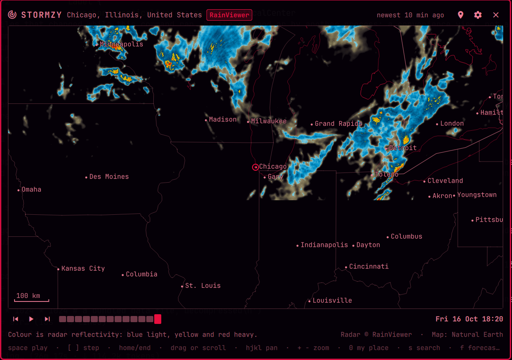

# Stormzy

Live weather radar in the Omarchy bar, for the place you choose.



Pick a city and Stormzy shows the last couple of hours of radar over it,
looping, on a map drawn in your theme's colours. Over Japan it uses the
Japan Meteorological Agency's five-minute nowcast, including the hour of
forecast JMA publishes; everywhere else it uses RainViewer's composite of
national radar networks. Four more layers sit beside the rain: temperature,
wind, air quality and cloud imagery, from whichever public source covers
the place. The place is always yours to choose: nothing is ever guessed
from your IP address, and there is no location tracking.

## Install

```sh
omarchy plugin add https://github.com/weedwhitesandwine/stormzy.git --enable
```

Click the bar icon, open settings with the gear (or `s`), and type a city:
`Tokyo`, `Osaka`, `London, UK`, `New York`, `Seattle`. A country on its own
lists its biggest cities. Recent places become one-click chips, so switching
between the cities you move between is quick.

## Layers

| Layer | Over Japan | Elsewhere |
| --- | --- | --- |
| Rain | JMA nowcast tiles, 5-minute, 3 h back and 1 h ahead | RainViewer composite tiles, 10-minute, 2 h back |
| Temp | JMA temperature-distribution tiles, 3-hourly, about a day ahead | Open-Meteo values on a grid of points, interpolated into a heat map |
| Wind | AMeDAS station observations, every 10 minutes, drawn as arrows | Open-Meteo values on a grid of points, drawn as arrows |
| Air | World Air Quality Index station tiles (US AQI); Open-Meteo points if the tiles stop answering | the same |
| Clouds | Himawari infrared tiles, 10-minute, 3 h back | Not published: the layer says so |

Click a layer chip or press its key: `r` `t` `w` `a` `c`. Tiled layers
have a timeline; point layers show the observation time instead.

## Using it

| Key | Action |
| --- | --- |
| `r` `t` `w` `a` `c` | Rain, temperature, wind, air quality, clouds |
| Space | Play / pause the loop |
| `[` `]` | Step one frame |
| Home / End | Oldest frame / newest observation |
| `h` `j` `k` `l` or arrows | Pan |
| `+` `-` | Zoom |
| `0` | Back to the chosen place |
| `s` or `/` | Settings and place search |
| `f` | Show or hide forecast frames (JMA) |
| Esc | Close |

Drag the map to pan and scroll to zoom. The timeline under the map is one
tick per frame; forecast frames are outlined, observations are solid, and
clicking a tick selects it. The stamp beside it is the frame's observation
time in your local time zone; the header says how old the newest scan is.

The rain source follows the place: **Auto** picks JMA for a place in
Japan and RainViewer elsewhere. Either can be forced in settings. JMA's
legend is millimetres per hour; RainViewer's tiles use its own reflectivity
colour schemes, four of which can be chosen in settings. The temperature
legend is JMA's, in 5 °C bands, and the Open-Meteo heat map uses it too.
Wind arrows point downwind with the speed in metres per second beside
them. Air quality is the US AQI scale.

## What it runs, reads and writes

The shell starts one helper, `stormzyd.py` (Python 3, standard library
only), under `setpriv --pdeathsig TERM` so it ends with the shell. It is the
only part of Stormzy that touches the network:

| Host | When | What |
| --- | --- | --- |
| `www.jma.go.jp` | Rain, Temp or Clouds over Japan; Wind over Japan | Frame indexes (small JSON files) and 256 px tiles for the area on screen; the AMeDAS station table (once a week, kept on disk) and the latest observations (every ten minutes) |
| `api.rainviewer.com` | Rain elsewhere | The frame index (one small JSON file) |
| `tilecache.rainviewer.com` | Rain elsewhere | 256 px PNG tiles for the area on screen |
| `tiles.aqicn.org` | Air | 256 px PNG tiles of station markers for the area on screen |
| `api.open-meteo.com` | Temp or Wind outside Japan | Current temperature and wind for up to 60 points over the view, one request |
| `air-quality-api.open-meteo.com` | Air, only if the WAQI tiles fail | Current air-quality indexes for up to 60 points over the view, one request |

Every request is HTTPS with a ten-second timeout, carries only a User-Agent
naming this plugin, and is read to a fixed ceiling (256 KB for an index,
1 MB for a tile or an API answer, 2 MB for the station table) and refused
above it. Point answers are kept for ten minutes, so panning back and forth
does not repeat them. A redirect to any other host is
refused. The frame index is refreshed once a minute while the window is
open and every ten minutes while it is closed; the latter can be turned off
in settings, after which nothing is fetched until the window opens.

Files:

| Path | What |
| --- | --- |
| `~/.local/state/omarchy/stormzy/settings.json` | The chosen place, recent places, zoom, source, colour scheme |
| `~/.cache/stormzy/tiles/` | Downloaded tiles, pruned to the frames the current index names and capped at 160 MB |
| `~/.cache/stormzy/amedastable.json` | The AMeDAS station table |

Nothing else on the machine is written. The window is opened from the bar
icon; `omarchy-shell shell toggle io.github.weedwhitesandwine.stormzy`
does the same from a script.

The basemap (coastlines, borders, state lines, lakes and city labels) is
Natural Earth, bundled under `data/`, so the map itself never leaves the
machine. The place search runs over a bundled GeoNames table of every town
above 5,000 people. `tools/build-data.py` regenerates those files from
their sources and is never run by the plugin.

## Update

```sh
omarchy plugin update io.github.weedwhitesandwine.stormzy
omarchy restart shell
```

## Remove

```sh
omarchy plugin remove io.github.weedwhitesandwine.stormzy
rm -rf ~/.cache/stormzy ~/.local/state/omarchy/stormzy
```

## Data and licence

Radar: [Japan Meteorological Agency](https://www.jma.go.jp/) high-resolution
precipitation nowcast and [RainViewer](https://www.rainviewer.com/).
Temperature, cloud imagery and station observations: JMA (weather
distribution, Himawari, AMeDAS). Air quality: the
[World Air Quality Index project](https://waqi.info/). Point weather and
air quality: [Open-Meteo](https://open-meteo.com/), CC BY 4.0.
Basemap: [Natural Earth](https://www.naturalearthdata.com/), public domain.
Places: [GeoNames](https://www.geonames.org/),
[CC BY 4.0](https://creativecommons.org/licenses/by/4.0/).
Code: MIT, see [LICENSE](LICENSE).

Built with Claude Code.
